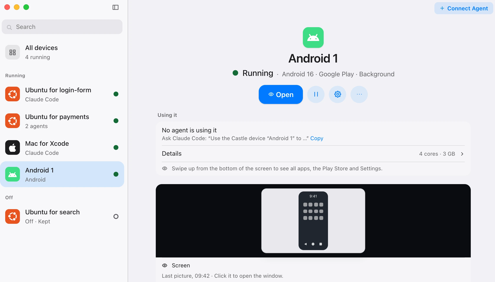
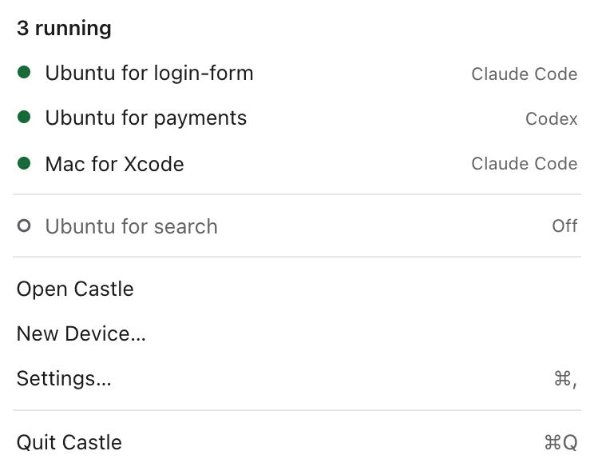

# Castle

On-call devices for AI agents.

Castle is a native Mac app with a menu bar item and a command line, made by Manly Beach Labs. This repository is where Castle's downloads and its issue tracker live. It holds no source code.

[**Download the latest Castle**](https://github.com/manlybeachlabs/castle/releases/latest/download/Castle.dmg)

Requires a Mac with Apple silicon and macOS 26 or later. Open the disk image and drag Castle to Applications. Every release and what changed in it is on the [Releases page](https://github.com/manlybeachlabs/castle/releases).

Buy a license at [castle.cx](https://castle.cx).

Screens from Castle's design prototype. The app may differ.

## Report a bug

[Open an issue](https://github.com/manlybeachlabs/castle/issues/new/choose) and pick "Bug report". Tell us which Castle and which macOS you have, which Mac you use, what happened and what you did just before. The form asks for each one. Please do not paste a license key into an issue.

To ask for something new, pick "Feature request" in the same place.

## Privacy

Castle sends no analytics and no usage data. Once a day it asks GitHub whether a newer version is out, by reading a file of this repository's latest release; the request carries Castle's version and your macOS version, nothing else. Castle talks to castle.cx only when you activate a license, about once a week to refresh it, and when you deactivate. If castle.cx is down or slow, Castle still opens and works, and it still updates.

## Contact

Write to [hello@manlybeachlabs.com](mailto:hello@manlybeachlabs.com), or visit [castle.cx](https://castle.cx).

Castle is independent. Product names belong to their owners.
